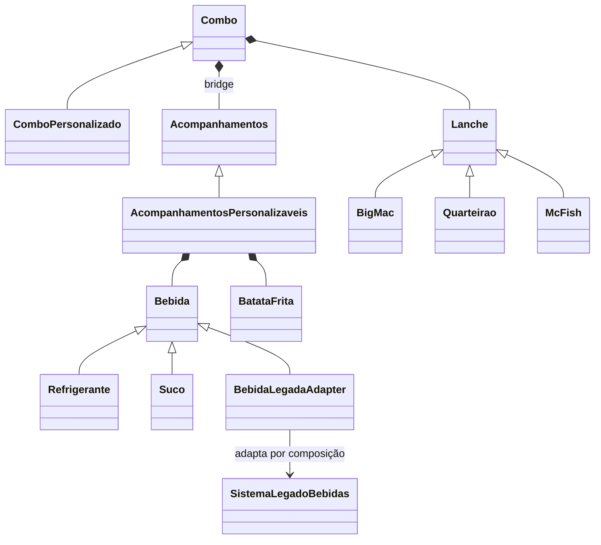

# Personalização de combos — Bridge e Adapter

Projeto prático em JavaScript com orientação a objetos e padrões estruturais GoF.

## Executar

Requisito: Node.js 18 ou superior. Não há dependências externas; não é necessário executar `npm install`.

```bash
npm start
npm test
```

Também é possível executar diretamente `node src/index.js` e `node --test`.

A demonstração é automática no terminal: monta cinco combos diferentes, altera a bebida e a batata de dois objetos existentes e cria um sexto combo com uma bebida adaptada do legado. As alterações acontecem durante a execução, sem recriar os combos. Não há menu interativo, pois o enunciado exige uma demonstração no terminal.

## Classes e responsabilidades

| Padrão / papel | Classe | Arquivo |
| --- | --- | --- |
| Bridge / Abstraction | `Combo` | `src/bridge.js` |
| Bridge / RefinedAbstraction | `ComboPersonalizado` | `src/bridge.js` |
| Bridge / Implementor | `Acompanhamentos` | `src/bridge.js` |
| Bridge / ConcreteImplementor | `AcompanhamentosPersonalizaveis` | `src/bridge.js` |
| Adapter / Target | `Bebida` | `src/itens.js` |
| Adapter / Adapter | `BebidaLegadaAdapter` | `src/adapter.js` |
| Adapter / Adaptee | `SistemaLegadoBebidas` | `src/legado.js` |

### Bridge

`Combo` mantém uma referência para `Acompanhamentos` e delega a descrição e as alterações dos acompanhamentos a essa implementação. `ComboPersonalizado` estende a abstração e acrescenta o número do combo. `AcompanhamentosPersonalizaveis` implementa o contrato e compõe uma `Bebida` e uma `BatataFrita`.

O lanche também é composto no combo, por meio da classe base `Lanche` e suas subclasses `BigMac`, `Quarteirao` e `McFish`. Assim, as opções podem ser combinadas sem classes como `ComboBigMacSuco700BatataGrande`. As três opções de lanche, seis bebidas e três batatas permitem **54 combinações**.

O Bridge está na separação entre a hierarquia de combos e a hierarquia de implementações dos acompanhamentos. A composição dos itens permite variar o conteúdo de cada implementação. Uma nova implementação de acompanhamentos pode herdar de `Acompanhamentos` sem modificar as classes de combo.

### Adapter

O legado recebe um código numérico em `buscarPorCodigo()` e devolve `{ produto, mililitros }`. O novo sistema trabalha com objetos que oferecem `descricao()`, definidos pela classe base `Bebida`.

`BebidaLegadaAdapter` herda de `Bebida`, mantém uma referência ao legado por composição e traduz sua resposta no método `descricao()`. O combo recebe a bebida adaptada como qualquer outra bebida. A conversão fica inteiramente no adapter; `legado.js` representa a API original simulada, pois o enunciado não fornece código de um sistema legado real.

| Volume | Refrigerante | Suco |
| --- | --- | --- |
| 300 ml | 101 | 201 |
| 500 ml | 102 | 202 |
| 700 ml | 103 | 203 |

### Integração dos padrões



Exemplo de construção do combo com os dois padrões:

```javascript
const bebida = new BebidaLegadaAdapter(new SistemaLegadoBebidas(), 202);
const combo = new ComboPersonalizado(6, new McFish(),
  new AcompanhamentosPersonalizaveis(bebida, new BatataFrita('média')));
console.log(combo.descricao());
// Combo 6: McFish | Suco 500 ml | Batata frita média
```

As classes desse exemplo estão exportadas nos arquivos da pasta `src`; consulte os imports em `src/index.js`.

## Validação e evidências

Os arquivos `evidencias-execucao.txt` e `evidencias-testes.txt` registram saídas reais do programa e dos testes. A verificação automatizada cobre:

- As 54 combinações distintas.
- Os seis códigos de bebida legada usados em combos pelo Adapter.
- A alteração do mesmo objeto combo e a independência de outro combo.
- A rejeição de itens ausentes, opções inválidas e códigos inexistentes.

Resultado da execução: **4 testes aprovados, 0 falhas**. Se a entrega exigir capturas de tela, execute os comandos e capture o terminal; os arquivos de texto já permitem conferir a saída completa.

## Publicar no GitHub

Este projeto ainda não foi publicado. Crie um repositório vazio na sua conta do GitHub, por exemplo `combos-gof-adapter-bridge`, sem adicionar README na criação. Depois, no terminal dentro desta pasta:

```bash
git init
git add .
git commit -m "Implementa combos com Bridge e Adapter e registra evidências"
git branch -M main
git remote add origin https://github.com/SEU-USUARIO/combos-gof-adapter-bridge.git
git push -u origin main
```

Substitua `SEU-USUARIO` pelo seu usuário. A autenticação será feita com sua conta do GitHub. Entregue ao professor o link do repositório após a publicação. Confira a visibilidade necessária para que ele consiga acessá-lo.
